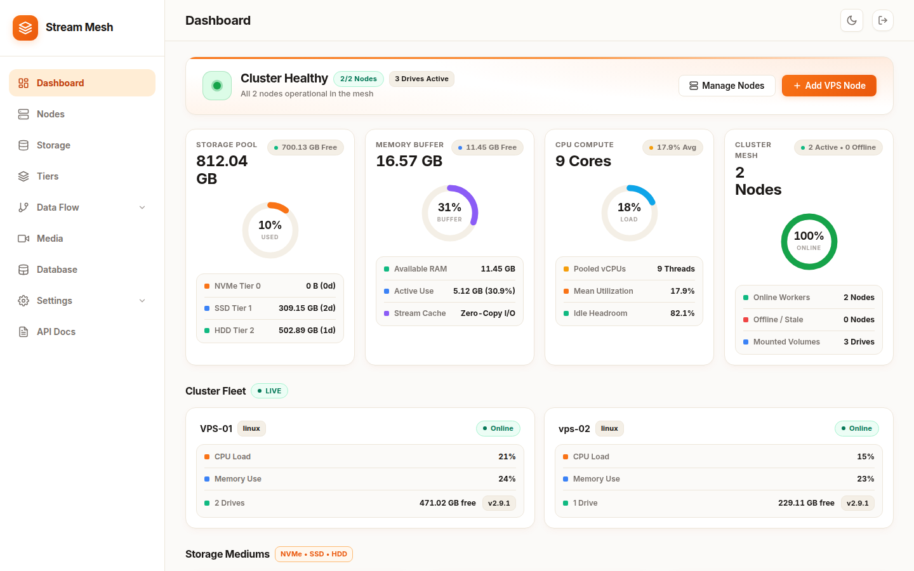
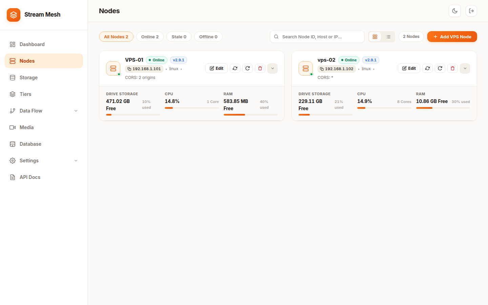
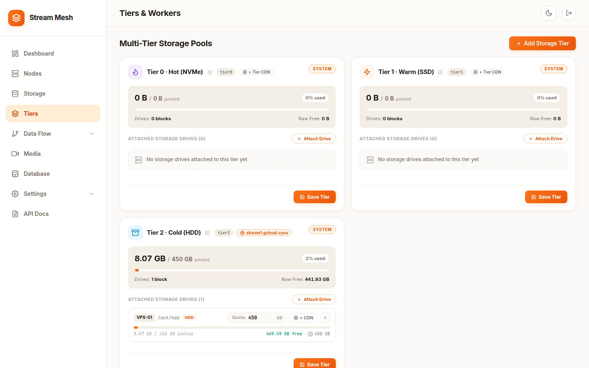
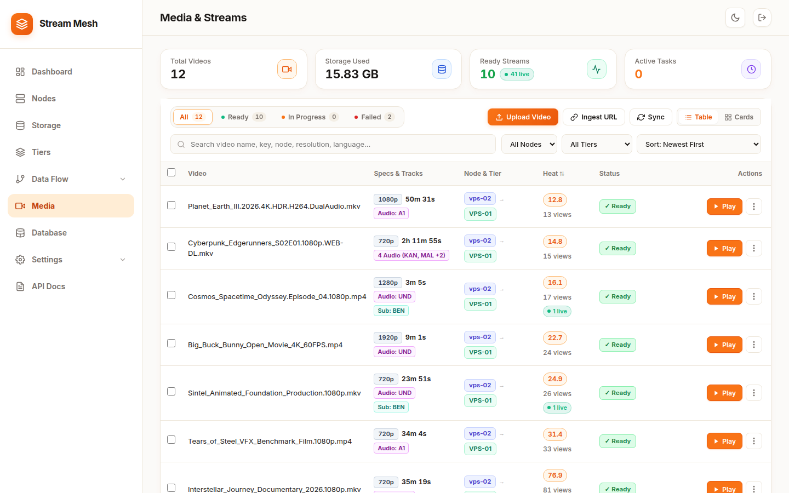

# Stream

**Distributed multi-node storage mesh, automated HLS/CMAF video packager, and high-concurrency byte-range streaming coordinator written in Go.**

[](https://goreportcard.com/report/github.com/masudranaxpert/storage)
[](LICENSE)
[](go.mod)
[](#architecture)

Stream scales video hosting across low-cost heterogeneous VPS providers (Hetzner, OVH, Netcup, Contabo, AWS, Cloudflare R2). It coordinates worker nodes over persistent gRPC telemetry, decouples heavy FFmpeg remuxing onto temporary scratch disks, and serves byte-range fMP4/CMAF streams directly to end-users without coordinator bandwidth bottlenecks.

---

## Visual Tour

<div align="center">

### Cluster Fleet & Real-time Telemetry


### Multi-VPS Worker Nodes & Health Metrics


### Tiered Storage (NVMe, SSD, HDD & S3/R2 Buckets)


### Video Ingest & Stream Packages


</div>

---

## Benchmark & Performance

Tested on a live production worker node (**VPS-01: AMD Ryzen 9 7950X3D, Mechanical HDD Storage, 1 Gbps NIC**) under simulated multi-viewer playback via dedicated high-bandwidth test runners.

| Benchmark Test Scenario | Concurrent Viewers | Chunk Size | Duration | Total Requests | Error Rate | Transferred Data | Throughput (RPS) | Sustained Bandwidth | Latency (p50) |
| :--- | :---: | :---: | :---: | :---: | :---: | :---: | :---: | :---: | :---: |
| **Light Playback Ramp** | **1,000** | 512 KB | 10s | 2,821 | **0.00%** | 1.14 GB | 281.5 req/s | **929.19 Mbps** (~116 MB/s) | 2.88s |
| **Heavy Buffer Spike** | **10,000** | 512 KB | 15s | 4,428 | **0.00%** | 1.69 GB | 293.7 req/s | **920.61 Mbps** (~115 MB/s) | 13.57s |
| **Realistic Stream Peak** | **10,000** | 128 KB | 15s | 14,713 | **0.00%** | 1.68 GB | **975.1 req/s** | **913.67 Mbps** (~114 MB/s) | 8.57s |
| **Long-Run Seek Playback (R1)** | **1,000** | 256 KB | **60s** | 7,784 | 3.62% | 1.61 GB | 129.5 req/s | **218.87 Mbps** (~27 MB/s) | 2.17s |
| **Long-Run Seek Playback (R2)** | **1,000** | 256 KB | **60s** | 6,880 | 4.14% | 1.38 GB | 114.4 req/s | **187.36 Mbps** (~23 MB/s) | 5.60s |

### Hardware & Network Takeaways
- **1 Gbps NIC Saturation:** Sustained line-rate throughput at **913 – 929 Mbps** (~93% physical link saturation) with zero dropped connections during 10k concurrent spikes.
- **Micro-Footprint:** Idle RAM is ~60 MB; under 10k connections peak RAM stays under **295 MB** with ~12% single-core CPU utilization.
- **Spindle HDD Seeks:** Mechanical HDD head-thrashing under random viewer seeks is mitigated by chunk section buffers, sustaining **187 – 219 Mbps** continuous throughput over extended 60-second intervals.

---

## Key Capabilities

- **Zero-Redirect Direct Streaming:** Coordinator generates cryptographically signed opaque stream tickets (`/stream/t_...`). Edge workers serve HTTP 206 Partial Content with zero hop-penalties and full CORS enforcement.
- **Smart Audio Multiplexing:** Single-track audio is muxed directly into `stream_0.m4s` to minimize fragment overhead; multi-track audio automatically demuxes into separate rendition playlists (`stream_{lang}.m3u8`).
- **Resilient Decoupled Ingest:** Remote downloads and FFmpeg packaging execute on worker scratch storage before transfer to the final storage target via a 12-stream parallel transfer protocol with exponential backoff and resume support.
- **Zero-Dependency S3/Cloudflare R2 Client:** Built-in AWS SigV4 signer using Go standard library (`crypto/hmac`, `crypto/sha256`, `net/http`) — zero bloated external AWS SDKs.
- **Automated Heat-Based Storage Tiering:** Tracks real-time access heat with half-life decay algorithms, automatically promoting viral media to NVMe/SSD and demoting cold archives to HDDs.
- **Self-Healing Cluster SSH Provisioner:** Add remote Debian/Ubuntu nodes in seconds with `./stream add-vps`. Self-contained binaries auto-deploy, configure systemd daemons, and join the gRPC mesh.

---

## Quickstart

### 1. Compile Single Binary

```bash
git clone https://github.com/masudranaxpert/storage.git
cd storage
go build -o stream ./cmd/stream
```

### 2. Start Coordinator Node

```bash
# Starts web UI on :1212 and gRPC mesh hub on :9091
./stream coordinator --port=1212 --grpc-port=9091
```

Access the dashboard at `http://localhost:1212`.

### 3. Join Worker Agent Node

```bash
./stream agent \
  --join=http://COORDINATOR_IP:1212 \
  --grpc=COORDINATOR_IP:9091 \
  --port=2052 \
  --media-dir=/mnt/storage/media \
  --secret=CLUSTER_SHARED_SECRET
```

---

## CLI Reference

| Command | Description | Default Port / Flags |
| :--- | :--- | :--- |
| `./stream coordinator` | Launches cluster control plane, BadgerDB, and UI | `--port=1212 --grpc-port=9091` |
| `./stream agent` | Starts storage & byte-range streaming worker daemon | `--port=2052 --interval=5s` |
| `./stream add-vps` | Automates SSH deployment of worker onto remote server | `--host --user --pass/key --dir` |
| `./stream status` | Prints telemetry and operational state of connected nodes | — |
| `./stream check` | Verifies host runtime prerequisites (`ffmpeg`, `aria2c`) | — |

---

## Core HTTP API Reference

All write endpoints require `X-Cluster-Secret` or a valid `X-API-Key` header.

| Endpoint | Method | Description |
| :--- | :---: | :--- |
| `/api/v1/files` | `POST` | Ingest video by URL (`{"url": "https://..."}`) or upload |
| `/api/v1/files` | `GET` | List all tracked media packages, states, and metadata |
| `/api/v1/files/{key}` | `GET` | Inspect file metadata, stream URL, and placement details |
| `/api/v1/files/{key}/retry`| `POST` | Re-queue and re-process failed downloads |
| `/api/v1/files-sync` | `POST` | Reconcile disk state and purge ghost records (`?force=true`) |
| `/stream/{token}` | `GET` | Stream fMP4 segment or master playlist (HTTP 206 Byte Range) |
| `/api/pool` | `GET` | Real-time cluster metrics, CPU, RAM, disk quotas, and node health |
| `/api/storage/clean` | `POST` | Clean orphaned scratch artifacts and optimize disks |

---

## Architecture Overview

```
                      ┌───────────────────────────────────────────────┐
                      │              Web Dashboard / API             │
                      │           Stream Coordinator (:1212)         │
                      │  - BadgerDB Storage Registry & Placements    │
                      │  - Heat-Decay Tier Lifecycle Engine          │
                      └───────┬───────────────────────────────┬───────┘
                              │ gRPC Persistent Streams       │
                              │ Control Plane (:9091)         │
               ┌──────────────┴───────────────┐               │
               ▼                              ▼               ▼
┌─────────────────────────────┐┌─────────────────────────────┐┌───────────────────────────┐
│     Worker Node VPS-01      ││     Worker Node VPS-02      ││    Cloud Storage Bucket   │
│  - Port :2052 (HTTP Range)  ││  - Port :2052 (HTTP Range)  ││  - Cloudflare R2 / S3     │
│  - Tier 2 HDD Media Mount   ││  - Tier 1 SSD Media Mount   ││  - Native SigV4 Direct    │
│  - Ingest & FFmpeg Remux    ││  - Parallel Transfer Ingest ││  - Public CDN Redirect    │
└─────────────────────────────┘└─────────────────────────────┘└───────────────────────────┘
               ▲                              ▲
               └──────────────┬───────────────┘
                              │ Direct HTTP 206 Partial Content (Bytes: start-end)
                              ▼
                     [ 10,000+ Viewers / ArtPlayer / HLS.js ]
```

---

## Requirements & Production Notes

- **Coordinator Node:** Linux (amd64/arm64) or macOS, 512 MB RAM minimum.
- **Worker Agent Nodes:** Linux (Debian/Ubuntu recommended), `ffmpeg` installed on `$PATH` for fMP4/CMAF remuxing, `aria2c` for accelerated 16-thread downloads.
- **System Limits for High Concurrency:** When running 1,000+ simultaneous connections on worker agents, ensure system limits are set in systemd:
  ```ini
  [Service]
  LimitNOFILE=1048576
  LimitNPROC=524288
  TasksMax=infinity
  ```

---

## License

This project is open-source under the [MIT License](LICENSE).
